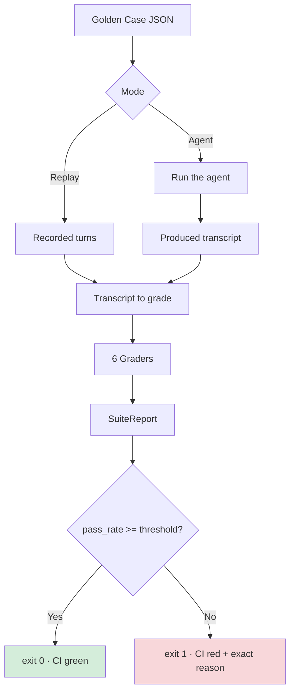
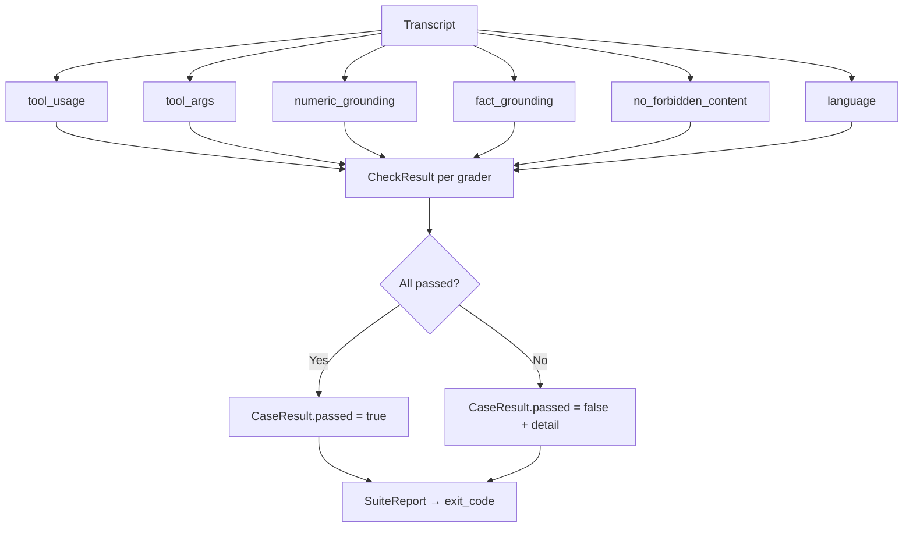

Testing an agent is weird. A normal test verifies a function: input, output, done. An agent decides at runtime which tool to call, with which arguments, and what to say back. If you test it by the text it returns, every model change breaks the suite and every real bug hides inside a snapshot nobody reads.

There's a known escape hatch: an LLM "judge" that scores the answer. It's flexible, but I hit three problems with it. It's not deterministic (same input, different verdict depending on the day). It's not cheap (a call per case, per iteration). And it's not diagnosable: when it fails it doesn't tell you WHAT broke — a tool called wrong, a number invented, or the wrong language.

## The alternative: golden cases and deterministic graders

The idea is to separate the two things the judge mixes. First, the case: an input, the tools it may use, and what's actually expected.

```json
{
  "id": "refund-status",
  "prompt": "What is the status of my refund?",
  "expected_tools": ["kb_search"],
  "expected_tool_args": { "kb_search": { "query": "refund status" } },
  "expected_numbers": ["1234"],
  "expected_facts": ["refund 1234 was approved"],
  "forbidden_phrases": ["as an AI I cannot"],
  "expected_language": "en"
}
```

The recorded turns (prompt, response, and each tool call with its result) live in the same case. That lets the suite run in replay mode: it grades the recorded transcript without calling the agent, the model, or the network.

Second, the grader: every rule is a program that receives the conversation and the case, and returns pass/fail with a reason. No model in the middle.

The six graders in the harness:

- **`tool_usage`**: it called every tool in `expected_tools` and none of the ones in `forbidden_tools`. Deleting an account or firing an escalation email when it should have searched the knowledge base is a real bug, not a style choice.
- **`tool_args`**: each tool can declare the subset of arguments it must have been called with; if no call matches, it fails.
- **`numeric_grounding`**: every number the agent states has to appear in some tool call's result, and every number the case demands has to appear in the response. When it fails it names the offending number: the KB says 1234, the agent answered 9999.
- **`fact_grounding`**: the expected claim has to appear in the response AND be backed by a tool call result. It's not "the answer is correct", it's "the answer cites what it says".
- **`no_forbidden_content`**: phrases the agent must never say ("as an AI I cannot...", promising what it cannot deliver). Matching ignores case, accents, and punctuation.
- **`language`**: the answer has to be in the language the user wrote in, detected with stopwords, without asking a model anything.

Then the CLI runs every case, prints a table with the exact reason each one failed, computes the pass rate, and exits non-zero when it drops below the threshold:

```bash
PYTHONPATH=src python3 -m agent_evals.cli cases.json --threshold 1.0
```

`--report` writes the same verdicts as a JSON artifact for CI to keep. That's what makes it usable in CI: the exit code cuts the build.


## The flow of a case



Each case runs through all six graders in parallel; every grader returns a
`CheckResult` with a reason. The runner aggregates them into a `SuiteReport`
and exits non-zero when the pass rate drops below the threshold.



## Where this does NOT reach

Deterministic evals verify facts, calls, and limits. They don't verify whether the answer is *good*.

- Did it actually help the user? Is it clear? Is the tone right? → subjective, and an LLM judge (or a person) is still the only reasonable tool.
- Did the agent take the most efficient path? That's a cost and latency problem, not a correctness one.

The LLM judge only enters where graders cannot reach, and it runs over a small subset, not the whole suite. If the judge is the only thing evaluating, what you have is not a test: it's an opinion with latency.

## The asset

I left it in [ramiro-c/agent-evals](https://github.com/ramiro-c/agent-evals): the package, the graders, the runner, the tests, and a synthetic support-agent example with one case per failure mode. It's framework-agnostic and stdlib-only, so it drops into any pipeline without touching the environment.

One caveat: the harness I run in production lives in a private repo. What's public is the method and a toy example, not the production code. If the idea is useful to you, copy the case format.
