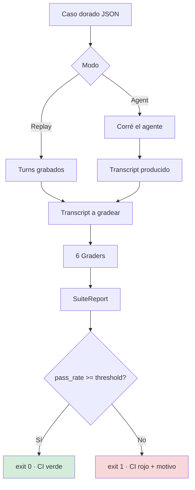
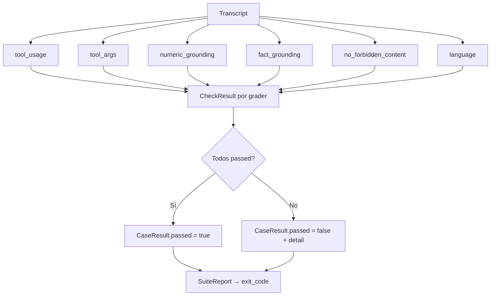

Probar un agente es raro. Un test normal verifica una función: entrada, salida, listo. Un agente decide en runtime qué herramienta usar, con qué argumentos, y qué contestar. Si lo probás por el texto que devuelve, cada cambio de modelo te rompe el suite y cada error real se esconde adentro de un snapshot que nadie lee.

Hay una salida conocida: un "juez" con LLM que califica la respuesta. Es flexible, pero me topé con tres problemas. No es determinista (la misma entrada se califica distinto según el día). No es barato (pagás una llamada por caso, por iteración). Y no es diagnosticable: cuando falla no te dice QUÉ se rompió — una herramienta mal llamada, un número inventado, o el idioma incorrecto.

## La alternativa: casos dorados y graders deterministas

La idea es separar las dos cosas que el juez mezcla. Primero, el caso: una entrada, las herramientas que puede usar y qué se espera realmente.

```json
{
  "id": "refund-status",
  "prompt": "¿Cuál es el estado de mi reembolso?",
  "expected_tools": ["kb_search"],
  "expected_tool_args": { "kb_search": { "query": "estado reembolso" } },
  "expected_numbers": ["1234"],
  "expected_facts": ["reembolso 1234 fue aprobado"],
  "forbidden_phrases": ["como IA no puedo"],
  "expected_language": "es"
}
```

Los turnos grabados (prompt, respuesta y cada tool call con su resultado) viven en el mismo caso. Eso permite correr el suite en modo replay: califica el transcript grabado sin llamar al agente, al modelo ni a la red.

Segundo, el grader: cada regla es un programa que recibe la conversación y el caso, y devuelve pass/fail con un motivo. Sin modelo en el medio.

Los seis graders del harness:

- **`tool_usage`**: llamó a todas las tools de `expected_tools` y a ninguna de `forbidden_tools`. Borrar una cuenta o mandar un email de escalamiento cuando tocaba consultar la base de conocimiento es un bug real, no un detalle de estilo.
- **`tool_args`**: cada tool puede declarar el subconjunto de argumentos con el que debe haber sido llamada; si ninguna call matchea, falla.
- **`numeric_grounding`**: todo número que el agente afirma tiene que aparecer en el resultado de alguna tool call, y todo número que el caso exige tiene que aparecer en la respuesta. Cuando falla nombra el número ofensor: el KB dice 1234, el agente contestó 9999.
- **`fact_grounding`**: la afirmación esperada tiene que aparecer en la respuesta Y estar respaldada por una tool call. No es "la respuesta es correcta", es "la respuesta cita lo que dice".
- **`no_forbidden_content`**: frases que el agente nunca debe decir ("como IA no puedo...", prometer lo que no puede hacer). El matching ignora mayúsculas, acentos y puntuación.
- **`language`**: la respuesta tiene que estar en el idioma que usó el usuario, detectado con stopwords, sin pedirle nada a un modelo.

Después el CLI corre todos los casos, imprime una tabla con el motivo exacto de cada falta, calcula el pass-rate y sale con exit code distinto de cero cuando baja del umbral:

```bash
PYTHONPATH=src python3 -m agent_evals.cli casos.json --threshold 1.0
```

`--report` escribe los mismos veredictos como artefacto JSON para el CI. Eso es lo que lo hace usable en CI: el exit code corta el build.


## El flujo de un caso



Cada caso pasa por los seis graders en paralelo; cada grader devuelve un `CheckResult` con el motivo. El runner los agrega en un `SuiteReport` y sale con exit code 0 o 1 según el umbral.



## Dónde esto NO alcanza

Los evals deterministas verifican hechos, llamadas y límites. No verifican si la respuesta es *buena*.

- ¿Ayudó de verdad al usuario? ¿Es clara? ¿Es el tono correcto? → subjetivo, y un juez LLM (o una persona) sigue siendo la única herramienta razonable.
- ¿El agente tomó el camino más eficiente? Eso es un problema de costo y latencia, no de correctitud.

El juez LLM entra solo donde los graders no llegan, y sobre un subconjunto chico, no sobre todo el suite. Si el juez es el único que evalúa, lo que tenés no es un test: es una opinión con latencia.

## El asset

Lo dejé en [ramiro-c/agent-evals](https://github.com/ramiro-c/agent-evals): el paquete, los graders, el runner, los tests y un ejemplo sintético de agente de soporte con un caso por modo de falla. Es framework-agnostic y solo stdlib, así que entra en cualquier pipeline sin tocar el entorno.

Un caveat: el harness que uso en producción vive en un repo privado. Lo que está afuera es el método y un ejemplo de juguete, no el código de producción. Si la idea te sirve, copiá el formato de caso.
