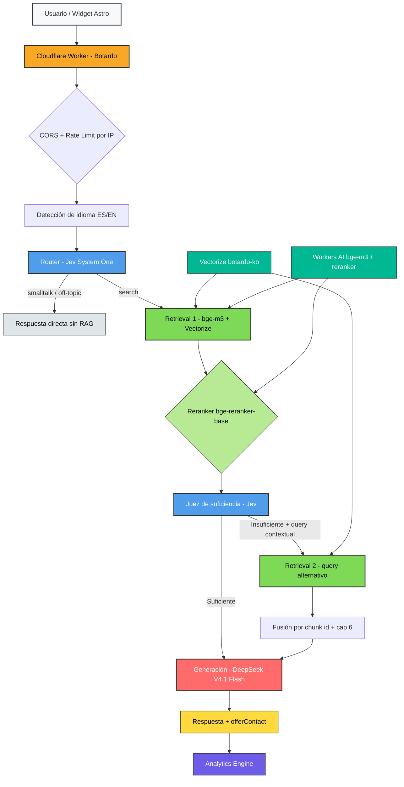
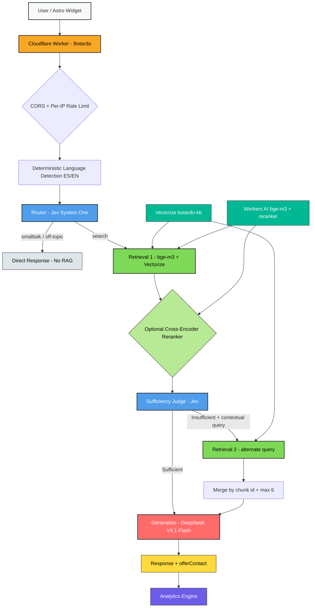

---
slug: botardo
kind: personal
status: live
featured: true
track: "ai-systems"
order: 3
tags: ["Cloudflare", "RAG", "TypeScript", "Workers AI", "Jev", "Vectorize"]
repo: https://github.com/ramiro-c/ramirocerda
es:
  title: "Botardo — Asistente IA con RAG Adaptativo"
  summary: "Agente conversacional con RAG adaptativo embebido en la web: router con modelo de decisión Jev, retrieval vectorial sobre Cloudflare Vectorize con embeddings bge-m3, reranker cross-encoder opcional, juez de suficiencia y generación con DeepSeek V4.1 Flash vía OpenCode Go."
  problem: "Mi web personal era estática y respondía igual a todos los visitantes. Quería que mi perfil fuera consultable de forma natural, con un asistente que responda con hechos de una base de conocimiento curada, sin alucinar ni inventar datos."
  what: "Diseñé Botardo como un Cloudflare Worker con pipeline RAG adaptativo. Un router con Jev (System One) clasifica el mensaje en search/smalltalk/off-topic, decide si necesita historial y extrae intención de contacto. En caso de búsqueda, recupera con bge-m3 desde Vectorize, aplica reranker bge-reranker-base si está habilitado y, con un juez de suficiencia, decide si hace falta una segunda búsqueda con query contextual (máximo 2 búsquedas por turno). Se genera con DeepSeek V4.1 Flash vía OpenCode Go. Detección de idioma determinística, fallback sin LLM fuera de contexto, rate limiting por IP, CORS acotado, Analytics Engine y secret management. La knowledge base se sincroniza dinámicamente desde src/content/notes y src/content/projects en ambos idiomas."
  highlights:
    - "RAG adaptativo: router + juez de suficiencia + hasta 2 búsquedas con fusión por chunk id."
    - "Retrieval con Workers AI (bge-m3) + Vectorize + reranker cross-encoder opcional (@cf/baai/bge-reranker-base)."
    - "Modelo de decisión Jev (free con fallback a paid) + generación DeepSeek V4.1 Flash vía OpenCode Go."
    - "Indexado dinámico de proyectos y notas en es/en desde el repo."
    - "Detección determinística de idioma, fallback sin LLM, CORS acotado, rate limiting y Analytics Engine."
    - "Tests con Vitest, typecheck, deploy automatizado con Wrangler y CI gates."
  stack: ["Astro", "TypeScript", "Cloudflare Workers", "Cloudflare Vectorize", "Workers AI", "OpenCode Go", "System One (Jev)", "DeepSeek V4.1 Flash", "Analytics Engine", "Vitest"]
en:
  title: "Botardo — Adaptive RAG AI Assistant"
  summary: "A RAG-powered conversational agent embedded in the site with an adaptive retrieval pipeline: Jev decision router, vector search over Cloudflare Vectorize with bge-m3 embeddings, optional cross-encoder reranker, sufficiency judge, and generation with DeepSeek V4.1 Flash via OpenCode Go."
  problem: "My personal site was static and answered every visitor the same way. I wanted my profile to be naturally queryable, with an assistant that answers with facts from a curated knowledge base — without hallucinating or inventing data."
  what: "I built Botardo as a Cloudflare Worker with an adaptive RAG pipeline. A Jev (System One) router classifies each message (search/smalltalk/off-topic), detects hire intent and whether history is needed, and produces a raw + contextual query. For search, it embeds with bge-m3 (Workers AI), queries Vectorize, optionally reranks with bge-reranker-base, runs a sufficiency judge, and if needed re-searches with the contextual query (max 2 searches per turn, merged by chunk id). Replies are generated with DeepSeek V4.1 Flash via OpenCode Go. Includes deterministic language detection, no-LLM fallback for out-of-context questions, per-IP rate limiting, origin-restricted CORS, Analytics Engine logging, and secret management. The knowledge base is auto-synced from src/content/notes and src/content/projects in both languages."
  highlights:
    - "Adaptive RAG: router + sufficiency judge + up to 2 searches with dedup/merge by chunk id."
    - "Retrieval with Workers AI (bge-m3) + Vectorize + optional cross-encoder reranker (@cf/baai/bge-reranker-base)."
    - "Jev decision model (free with paid fallback) + DeepSeek V4.1 Flash generation via OpenCode Go."
    - "Dynamic indexing of projects and notes in es/en directly from the repo."
    - "Deterministic language detection, no-LLM fallback, restricted CORS, rate limiting and Analytics Engine."
    - "Vitest suite, typecheck, automated deploys with Wrangler and CI gates."
  stack: ["Astro", "TypeScript", "Cloudflare Workers", "Cloudflare Vectorize", "Workers AI", "OpenCode Go", "System One (Jev)", "DeepSeek V4.1 Flash", "Analytics Engine", "Vitest"]
--- 

## Arquitectura / Architecture

### Español

### English

